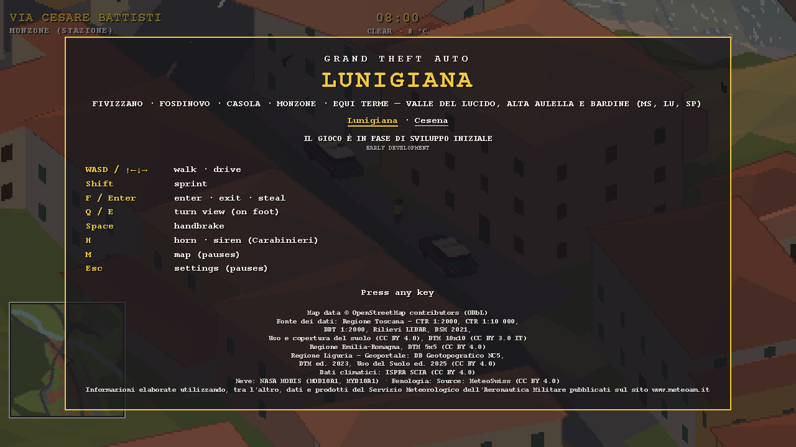
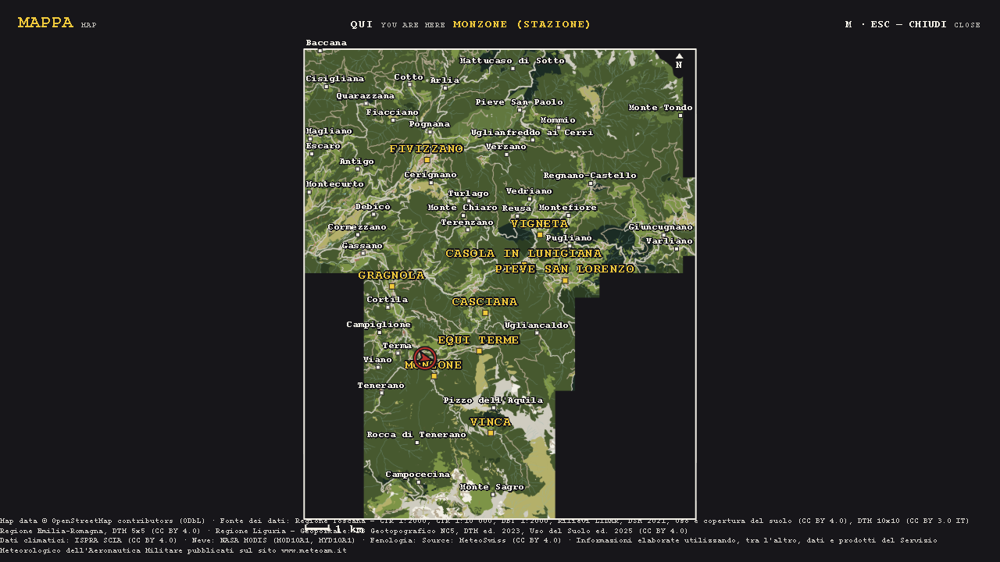

# Grand Theft Auto: Lunigiana

> [!WARNING]
> **Grand Theft Auto: Lunigiana is in early development.** Today you can play the Valle del Lucido and Fivizzano, Casola and the upper Aulella, 224 km², about a fifth of the planned map's 1,102 km², and a separate experimental Cesena city-centre map.



Grand Theft Auto: Lunigiana is an open-world car-theft game in isometric pixel art, set in Lunigiana, the valley of the Magra between Tuscany and Liguria. You walk village streets, steal parked cars (the Carabinieri’s Alfa Romeo included, from right outside their station), carjack traffic and run people down, on a map built from survey data of the real places. As many people are out as live nearby, so the village centres are busy and the country roads empty: villagers of every age walk alone, in couples, with their kids or a dog, stop to chat, glare at a speeding car, jump out of its way and are shocked by a death, while cats and dogs roam the villages and cows and pigs the farms. Trains run the real railway up the valley: an ATR 220 in Trenitalia’s regional livery calls at every station, level crossings ring, lower their barriers and hold the traffic for it, and you can climb into its cab and steal it too. The isometric camera turns a quarter at a time on foot, follows the car or the train while you drive so the way ahead is always up the screen, and renders at low resolution for a pixel-art look. A game day lasts 24 minutes under the real sun and moon, and the weather follows Italy’s climate at the map’s latitude and height, drawn day by day from national statistics: rain wets the roads, snow whitens the mountains, and both cost grip.

The game will cover all of Lunigiana, from the beaches at the mouth of the Magra to the Apennine ridge. Today the playable map is its eastern corner: [the Valle del Lucido, and Fivizzano, Casola and the upper Aulella](#the-playable-map-today-the-valle-del-lucido-and-fivizzano).

This is a fan project. It isn’t affiliated with or endorsed by Rockstar Games or Take-Two Interactive; “Grand Theft Auto” is their trademark.

## Where the game is set: Lunigiana

Lunigiana is the basin of the river Magra and its tributaries. For the game, it’s 21 comuni covering 1,102 km²:

- **Province of Massa-Carrara, Tuscany**: the 14 Lunigiana comuni, Aulla, Bagnone, Casola in Lunigiana, Comano, Filattiera, Fivizzano, Fosdinovo, Licciana Nardi, Mulazzo, Podenzana, Pontremoli, Tresana, Villafranca in Lunigiana and Zeri
- **Province of La Spezia, Liguria**: the 7 comuni of the lower Val di Magra, Sarzana, Santo Stefano di Magra, Vezzano Ligure, Arcola, Castelnuovo Magra, Luni and Ameglia

It runs from about 7 km of coast, between Punta Bianca and the Torrente Parmignola, up to the Apennine ridge between Monte Gottero and Monte Belfiore, which rises to 1,978 m on Monte Casarola. The Apuan Alps close it to the south-east.

### How the map grows, part by part

The map grows one part at a time from the Valle del Lucido, each built from the same survey sources. The parts come in this order, tracked in [#3](https://github.com/mastro993/gta-lunigiana/issues/3):

1. [Fivizzano, Casola and the upper Aulella](https://github.com/mastro993/gta-lunigiana/issues/17): the walled town of Fivizzano, the Verrucola fortress and the SS63 hairpins; playable ([below](#the-playable-map-today-the-valle-del-lucido-and-fivizzano))
2. [Fosdinovo, the Bardine valley and the Apuan foothills](https://github.com/mastro993/gta-lunigiana/issues/18): the Castello Malaspina on its crag, olive terraces and Colli di Luni vines
3. [Aulla and the Magra–Aulella–Taverone confluence](https://github.com/mastro993/gta-lunigiana/issues/19): the Fortezza della Brunella, the first motorway (the A15 della Cisa) and the first wide river
4. [Sarzana and the lower Val di Magra](https://github.com/mastro993/gta-lunigiana/issues/20): the first Ligurian part, with the fortresses of Sarzana and the A12–A15 junction
5. [The coast: Bocca di Magra, Marinella, Luni and Montemarcello](https://github.com/mastro993/gta-lunigiana/issues/21): the sea, sand beaches, the Magra mouth and ancient Luni
6. [Bagnone and its valley up to the Sillara–Matto–Marmagna ridge](https://github.com/mastro993/gta-lunigiana/issues/22): an arcaded borgo, its castles and passes up to 1,794 m
7. [Comano, the Lagastrello and the Cerreto](https://github.com/mastro993/gta-lunigiana/issues/23): the Apennine passes above Fivizzano, with the most reliable winter snow in Lunigiana
8. [The middle Magra: Villafranca, Filattiera, Mulazzo and Pontremoli](https://github.com/mastro993/gta-lunigiana/issues/24): Pontremoli’s Castello del Piagnaro and the chestnut country
9. [The Cisa, Brattello and Cirone passes](https://github.com/mastro993/gta-lunigiana/issues/25): the source of the Magra and the A15’s high viaducts and tunnels
10. [Zeri, the Gordana and Teglia valleys and the Passo dei Due Santi](https://github.com/mastro993/gta-lunigiana/issues/26): the Rossano plateau, sheep pastures and the Zum Zeri ski area

Parts 4 and 5 may swap. A single map file would exhaust a browser tab’s memory at about 320 km², less than a third of Lunigiana, so the map comes in 2 km tiles loaded on demand ([#5](https://github.com/mastro993/gta-lunigiana/issues/5)), and the parts build on the rest of the groundwork, issues [#4](https://github.com/mastro993/gta-lunigiana/issues/4) to [#12](https://github.com/mastro993/gta-lunigiana/issues/12): raw inputs out of git, motorways and other main roads, wide rivers and lakes, terrain where the LiDAR surveys stop, older building maps and the Ligurian sources.

### New landscapes

These landscapes come alongside the parts:

- **Sea, coast and beaches**: the sea at 0 m, sand and pebble beaches, piers and the mouth of the Magra ([#13](https://github.com/mastro993/gta-lunigiana/issues/13))
- **Forest types**: chestnut and oak in the valleys, beech above about 1,000 m and pines on the coast ([#14](https://github.com/mastro993/gta-lunigiana/issues/14))
- **Olive groves and vineyards**: on the hills, where they render as meadow today ([#15](https://github.com/mastro993/gta-lunigiana/issues/15))
- **Snow**: the season's snow line on the mountains by the game's date, lower on north faces, over woods bare from November to April ([#16](https://github.com/mastro993/gta-lunigiana/issues/16))

## The playable map today: the Valle del Lucido and Fivizzano

The map holds two parts of eastern Lunigiana, 224 km² from 105 m on the Aulella by Soliera up to 1,856 m by Cima Belfiore on the Apennine crest: the Valle del Lucido (78 km²) and, north and east of it, Fivizzano, Casola and the upper Aulella (146 km²).

The Valle del Lucido is a side valley of the Aulella in eastern Lunigiana, almost entirely in the comune of Fivizzano (province of Massa-Carrara). It runs a little over 14 km, from the flat, farmed valley floor at Gragnola, where the Lucido flows into the Aulella, up to pastures above 1,000 m in the northern Apuan Alps, under Pizzo d’Uccello and Monte Sagro. Local tradition calls the torrent *Lucido*, “bright”, for its clear water.

The Lucido has two branches, the Lucido di Vinca and the Lucido d’Equi, which meet on the valley floor at Monzone, under the 18th-century humpback bridge of Santa Lucia. Monzone has two halves: Ponte di Monzone along the road and the railway, and Monzone Alto on a rocky spur under the church of San Prospero.

Up the Equi branch, Equi Terme has sulphurous springs used since Roman times, karst caves open to visitors, a rock shelter (the Tecchia di Equi) with traces of Neanderthals and cave bears, and the Solco di Equi, a narrow canyon towards Pizzo d’Uccello.

Downstream, Gragnola, the valley’s historic market town, sits below the Malaspina Castello dell’Aquila. In the 19th century, marble quarried on Monte Sagro brought the valley a short period of prosperity; Monzone station’s freight yard served the marble trade, with the stone brought down by an aerial cableway. The Lucca–Aulla railway still climbs the valley through Gragnola, Monzone and Equi Terme.

Its part of the map covers the whole valley, ridge to ridge: 7.8 × 10 km, from Gragnola up to 1,800 m. It includes:

- **Monzone**: the station quarter on Via Cesare Battisti, the Carabinieri station, and the stone lanes of Monzone Alto
- **Vinca**: the stone village at the head of the western branch, at the end of the SP59’s hairpins, under Pizzo d’Uccello and Monte Sagro
- **Equi Terme**: the spa village up the eastern branch, with its own station, and above it the Solco di Equi gorge with the old marble road’s tunnels and its quarries
- **Gragnola**: the old town at the mouth of the valley, on the SR445 della Garfagnana and the Aulella, with the Castello dell’Aquila on the hill nearby
- **The hill villages**: Tenerano, Viano, Pieve di Viano, Colognola, Campiglione and Vezzanello west of the Lucido; Ugliancaldo on the ridge above the Solco
- **The Apuan ridge**: Pizzo d’Uccello’s north face, the Garnerone, Foce di Vinca, Monte Sagro and Monte Borla, with the white marble quarries of the Sagro basin
- **Hamlets and back roads**: Aiola, Mezzana, Codiponte and Casciana, with the woods, streams and hairpins in between

Fivizzano's part runs from the Aulella's gorge by Casola down to Soliera, where the Rosaro joins it, and up the Rosaro and the SS63 to the Apennine crest: 145.8 km², 89.9 of them in the comune of Fivizzano and 25.6 in Casola in Lunigiana, the rest on the edges of Minucciano and Sillano Giuncugnano (province of Lucca), Licciana Nardi and Comano. It includes:

- **Fivizzano**: the walled town on the SS63, above the Rosaro
- **Verrucola**: the hamlet under the Verrucola fortress, up the SS63 from Fivizzano
- **Casola in Lunigiana**: the village on the SR445 della Garfagnana, which climbs on past it to the Passo dei Carpinelli
- **The villages of the Aulella and the Rosaro**: Soliera, Gassano, Moncigoli, Vigneta, Castiglioncello, Signano, Turano and Pieve San Paolo, and Pieve San Lorenzo, Pugliano and Antognano in Minucciano
- **The railway on from Gragnola**: the Fivizzano-Gassano halt and Minucciano-Pieve-Casola station, between Rometta at the west edge and the Galleria del Lupacino by Pieve San Lorenzo
- **The Apennine side**: Mommio, the Passo di Tea and the Passo del Romito, the SS63 climbing toward the Cerreto pass, Monte Tondo, Monte Cucu and Cima Belfiore

Roads, rivers, woods and place names come from OpenStreetMap, and so does the railway, moved onto the surveyed track centrelines of Regione Toscana’s 1:2000 technical map (2019). That map also gives the buildings (with their surveyed eave heights), road widths and surfaces, the station platforms, and the old sidings and Gragnola’s loop as they lie, where its sheets map the ground (OpenStreetMap’s buildings fill in elsewhere); its 2009 edition gives the buildings and road surfaces of the Carrara side, and Regione Toscana’s 1:2000 topographic database (2011) those of Minucciano and Giuncugnano. The terrain comes from Regione Toscana’s 1 m LiDAR surveys (2010 and 2012), and where no flight covers it from its 2021 surface model on open ground and the 10 m terrain models of Massa-Carrara and Lucca, bent to meet them, and the bare rock, pastures and quarries from its land-cover map (2019), which also gives the woods' types (broadleaf, conifer, mixed) and the woods OpenStreetMap lacks. Each tree's species (chestnut, oak, beech, conifer or pine) is drawn from its wood's type, its height and the way its slope faces, by the shares of Regione Toscana's forest inventory.

## Screenshots of the Valle del Lucido

All screenshots come from today’s map:

| | |
|---|---|
|  |  |
| On foot in Monzone, next to the Carabinieri’s car | Over the Lucido in the stolen Giulia |
|  |  |
| The full map (M) | Gragnola, on the Lucido |
|  |  |
| Equi Terme | Monzone Alto and San Prospero |
|  |  |
| Vinca | The Solco di Equi and its quarries |

## Requirements to run and build the game

You need:

- **Node 24**: runs the TypeScript tests and map tools directly, with no build step; CI pins the exact version in `.node-version`
- **pnpm 10**: `packageManager` pins it in `package.json`, and `corepack enable` installs it
- **The GitHub CLI** (`gh`), signed in (`gh auth login`): `pnpm fetch-raw` downloads the map's inputs with it
- **A browser with WebGL**: plus Web Audio for the sound

## Play in the browser

Every push to `main` publishes the game to GitHub Pages at <https://gta-lunigiana.fedemas.dev/> (`.github/workflows/pages.yml`, which builds the maps first, or takes them from CI's cache).

## Run the game locally

Install the dependencies, download the map's inputs, build the maps and start the dev server:

```sh
pnpm install
pnpm fetch-raw
pnpm maps
pnpm dev
```

The maps are not in git, so a fresh clone or worktree builds them once: `pnpm fetch-raw` downloads 71.8 MB, and `pnpm maps` builds both maps and the L test region in about 100 s. The tests and `pnpm lint` read the built maps too.

Then open `http://localhost:5173`. The server listens on the local network too, so a phone or another computer on the same network can play: open the `Network` address that Vite prints. Anyone on that network can reach it, so stop it on a shared network you don't trust. Every load is a new world, starting on today’s date at 08:00 Rome time once you dismiss the title card. Add `?seed=N` (for example `http://localhost:5173/?seed=42`) to replay the same world: the seed drives every random choice, so the same seed and the same keys give the same game.

Choose **Cesena** on the title card, or open `http://localhost:5173/?map=cesena&seed=42`. Cesena is a separate 4 × 4 km map around the historic centre, with the Savio, the railway station and surrounding neighbourhoods. It uses OpenStreetMap streets and building footprints and Regione Emilia-Romagna's 5 m terrain model. It does not replace or extend Lunigiana. Building heights without OSM height tags and road widths are defaults, not surveyed Cesena measurements.

In dev mode, the backslash key toggles the Ritmo monitor, P toggles the debug menu, and `http://localhost:5173/lab.html` opens the audio audition page: every sound on a button, its params on sliders, heard from a distance you pick (see [docs/audio.md](docs/audio.md#the-audition-page)). The debug menu sets the time (stop the clock or run it 10 or 60 times faster, pick the time of day and the date, jump to sunrise or sunset), the weather (leave it to the day’s plan or force a regime, settled at once if you like, with this month’s odds and the weather seed read out) and the vehicle handling, and shows the trains: each line’s next train, each train and who drives it, and each level crossing’s arms, light and bell, with a button that calls a train onto every line no AI train runs on. The handling knobs it changes stay for the next load; the time and the weather do not (see [docs/weather.md](docs/weather.md#the-hud-and-the-dev-menu)).

## Controls on foot and driving

The same keys walk and drive; the table shows what each does in both modes:

| Key | On foot | Driving |
|---|---|---|
| W A S D or arrow keys | walk along the screen directions; in a river, wade or swim | up: throttle, down: brake and reverse, left/right: steer; in a train up and down drive toward and away from the cab’s way, against the motion they brake, and it backs up at 30 km/h at most |
| Shift | sprint; swimming, a hard crawl | |
| F or Enter | enter the nearest vehicle (steal, enter or carjack), or a train at a cab door when it is all but stopped | get out (from a train, only at a stand at grade) |
| Q / E | turn the view a quarter left / right | nothing: the view follows the car |
| Space | | handbrake (in a train, the emergency brake) |
| H | | horn while held; in the Carabinieri car, siren on or off; in a train, the train horn while held |
| M | full map (pauses the game); the wheel zooms it and a drag pans it; M, Esc or a click closes it; in dev builds a click on the play area teleports the player there first, to the nearest spot clear of buildings and walls | same |
| Esc | settings, which pause the game: the vehicle physics (Simulation, Balanced or Arcade; a new game starts on Balanced); Esc or Resume closes them. With the full map open, Esc closes the map instead | same |
| P (dev builds only) | debug menu: the time of day, the clock’s speed and the date, the weather, the vehicle physics presets and handling knobs for every vehicle at once, and the trains and level crossings; P closes it, and so does Esc while it has the focus | same |

Crashes wear vehicles out, the truck far less than a small car: a damaged engine pulls weaker and misfires, smokes white, then black, and once destroyed it burns and nobody can drive it again. 5–10 s later it explodes: the blast wrecks the cars beside it, which catch fire in turn, and kills the people nearby, you too if you are still inside or standing next to it; you come back on foot at the start 4 s later ([docs/gameplay.md](docs/gameplay.md#damage)).

The rivers rise in a storm and fall back over the following days. Shallow water slows you; deep or fast water lifts you off your feet and the current carries you downstream until you swim out, but you never drown. A flood floats parked cars off, and water over a car's air intake stalls its engine ([docs/water.md](docs/water.md)).

The bindings live in `bindings` in `src/sim/schema.ts`. The HUD shows the street and district you’re in, the time in Rome (HH:MM) with the weather and the temperature where you stand (for example “Rain · 9 °C”), the action the key would take, a speedometer while driving, a minimap, and “Sei morto” when you are killed. On screens 600 px wide or narrower the clock moves to the top-right corner. M, or a click on the minimap, opens the full map: the whole area north-up, drawn from a picture of it the map build paints (downloaded the first time you open it), with the villages, hamlets and main peaks named, the roads through tunnels dashed (on the minimap too) and your position marked; zoom in to see the streets and name the places it has no room for.

### Touch controls on a phone or tablet

Where a touch screen is the main pointer, the game runs in mobile mode: the controls are on the screen, so no keyboard or mouse is needed, and the game is always landscape. A phone held upright shows the game turned a quarter, to be held sideways. On Android, the first tap also takes the game full screen and locks it to landscape. On foot a stick walks; in a vehicle, buttons take its place. The controls press the same keys as the keyboard:

| Control | On foot | Driving |
|---|---|---|
| Stick: a thumb on the left half | walk along the screen directions | |
| ◀ / ▶ on the left | | steer left / right; hidden in a train, which has no steering |
| Gas / Brake on the right | | throttle / brake, then reverse |
| Run | sprint; swimming, a hard crawl | |
| Steal, Enter, Carjack or Exit (shown only when it would act) | enter the nearest vehicle | get out |
| ↺ / ↻ | turn the view a quarter left / right | hidden: the view follows the car |
| Hand brake | | handbrake (in a train, the emergency brake) |
| Horn | | horn while held; in the Carabinieri car, siren on or off; in a train, the train horn while held |
| A tap on the minimap | full map (pauses the game); a pinch zooms it and a drag pans it; a tap closes it | same |
| II, top right | settings (pauses the game); Resume closes them | same |

## How the game sounds

The browser synthesises every sound with Web Audio, with no sample files: engines voiced from how each is built and revved by the drive simulation (rough, knocking and misfiring once crashes wear them), trains (their diesel power packs, the wheels clacking over the rail joints, squealing brakes and the horn) and the level crossings’ bells, wrecks burning and then exploding, tyres that squeal when they skid, horns and the Carabinieri siren, crashes, footsteps, people chatting in Italian-sounding gibberish with a real word now and then (the way The Sims talk) and crying out in real Italian, cows, pigs, cats and dogs, wind, rain on the ground and on the car’s roof, thunder, crickets in warm, dry air, birds by day and the owl at night, the village church bells striking the game’s hours, and the Lucido and its streams.

Each sound reaches you through outdoor acoustics. It fades with distance and under the background noise, so you hear only what’s near. Houses and hills muffle it, the air dulls it, its pitch shifts as it passes, far crashes arrive late, and loud ones echo off the slopes.

The first key, click or tap once the game has loaded, the one that dismisses the title card, starts the sound. See [docs/audio.md](docs/audio.md) for the details.

## Package scripts

Every script runs with `pnpm`:

| Script | What it does |
|---|---|
| `pnpm dev` | Vite dev server on port 5173, open to the local network (`--host`) |
| `pnpm build` | production build into `dist/` (the Pages workflow adds `--base=./`) |
| `pnpm preview` | serves `dist/` on port 4173 |
| `pnpm check` | `format:check`, then `typecheck`, then `lint`, then `test`, then `test:long`, then `test:map` |
| `pnpm format` | `oxfmt`: formats the code, JSON, YAML, HTML and CSS in place |
| `pnpm format:check` | `oxfmt --check`: fails on any unformatted file |
| `pnpm typecheck` | `tsc` (no emit) |
| `pnpm lint` | type-aware `oxlint` with the Ritmo plugin and the project's own (`lint/`), warnings failing, then `ritmo-devtools lint src/lint.ts` |
| `pnpm test` | `node --test` over `src/**/*.test.ts` and `lint/**/*.test.ts`, each in a `__tests__` folder beside the module it tests; none of them checks every tile or feature of the map or takes 0.4 s or more alone, so it runs in about 11 s on a 14-core Mac |
| `pnpm test:long` | `node --test` over `src/**/*.long-test.ts`: the long checks (joyrides and replays, statistics over many seeds or renders, the weather calibration), each about 0.4 s or more alone |
| `pnpm test:map` | `node --test` over `src/**/*.map-test.ts`: the map checks, over every tile, chunk and feature of the built maps (run it after `pnpm map`) |
| `pnpm maps` | builds both maps and the L test region: `pnpm map`, then `pnpm map --region cesena`, then `pnpm map --region lunigiana-l` |
| `pnpm map` | rebuilds `src/sim/map/monzone.bin` and its tiles (`src/sim/map/monzone/`) from `data/raw`, baking the tables the game reads from them, and paints the full map's picture beside the tiles (`src/sim/map/monzone/overview.png`) |
| `pnpm map --region cesena` | rebuilds the separate `src/sim/map/cesena.bin`, its tiles and its full map's picture from pinned Cesena inputs |
| `pnpm map --region lunigiana-l` | builds a test region from Lunigiana's inputs into `test-maps/` (gitignored, never shipped): `lunigiana-l`, an L that CI builds and `pnpm test:map` checks, `lunigiana-lucido`, lucido's part alone, or `lunigiana-3x`, three times lucido's built terrain, for the build's memory and time, which `x3-region.map-test.ts` checks against `lunigiana-lucido` (both built by hand; [test regions](docs/map.md#test-regions)) |
| `pnpm fetch-raw` | downloads the map inputs `data/raw.lock.json` pins into `data/raw`, only those missing or different, checking each one's SHA-256 |
| `pnpm pin-raw` | uploads the inputs a fetch tool changed to a new `raw-YYYYMMDD` release and pins them in `data/raw.lock.json` |
| `pnpm fetch-osm <part>` | downloads a Lunigiana part's OpenStreetMap extract again into `data/raw/osm/<part>.osm.gz` (`lucido` or `fivizzano`), which the build merges with the other parts' |
| `pnpm fetch-osm --region cesena` | downloads the Cesena extract into `data/raw/osm/cesena.osm.gz` |
| `pnpm fetch-osm pontremoli-town` | downloads OpenStreetMap's buildings alone over the Pontremoli test region into `data/raw/osm/pontremoli-town.osm.gz`, which its map test checks the DBT against |
| `pnpm fetch-rt <part>` | downloads a Lunigiana part's Regione Toscana sources again into `data/raw/rt`: its surveys, its land cover into `ucs/<part>.json.gz`, and the terrain of the 2 km tiles it meets, mosaicked from every part's LiDAR and the fallback chain past it, into `dtm/<i>_<j>.bin`, adding the cells a tile's file lacks and keeping every cell another part's fetch wrote; `pnpm fetch-rt <part> ctr` only the surveys (the CTR 1:2000 sheets of 2019 and 2009, the CTR 1:10 000 sections and the DBT 1:2000 the part's manifest lists), leaving the terrain and the land cover as they are, and `pnpm fetch-rt <part> ucs` only the land cover; `pnpm fetch-rt --region bagnone-ridge` the Bagnone ridge test region's terrain into `data/raw/rt/bagnone-ridge`, `pnpm fetch-rt --region sarzana-town` the Sarzana test region's into `data/raw/rt/sarzana-town` (after `fetch-lig`, whose DTM crops it reads), and `pnpm fetch-rt --region pontremoli-town` the Pontremoli test region's DBT into `data/raw/rt/pontremoli-town` |
| `pnpm fetch-lig <part>` | downloads Regione Liguria's sources over a part into `data/raw/lig/<part>`: the NC5's buildings, minor buildings, carriageways and mapped area, the DTM ed. 2023's native cells cropped per 2 km tile, and the land use ed. 2025's kept classes; `pnpm fetch-lig sarzana-town` the Sarzana test region's |
| `pnpm fetch-rer --region cesena` | verifies the terrain licence and downloads Emilia-Romagna's DTM into `data/raw/cesena` |
| `pnpm rt-index <part>` | lists the Regione Toscana CTR 1:2000 sheets, the CTR 1:10 000 sections, LiDAR tiles and DBT 1:2000 blocks (each of these three with its archive's name and licence) and the DSM 2021 elements over a part into `.research/<part>/index.json`, for its manifest |
| `pnpm pick-sheets <part>` | the 2019 CTR sheets whose mapped area meets the part, against its manifest; `--write` updates `data/parts/<part>.json` |
| `pnpm pick-lidar <part> [--lots 004,005]` | replays `fetch-rt`'s first-wins LiDAR mosaic to keep the tiles that write a cell, report the holes and the DSM 2021 elements over them, against the manifest; `--write` updates it |
| `pnpm coverage <part>` | per comune, the share of the part mapped by the 2019 CTR, each LiDAR lot and, once fetched, each source of the terrain past the LiDAR, and OSM forest against the land cover's woods, as a table and a PNG |
| `pnpm footprint-check <part>` | villages and building clusters within 300 m of the edges of the part's play area (its mask, else its rectangles), and roads that leave it across them and come back |
| `pnpm ortho <x0>,<y0>,<x1>,<y1> [layer] [out.svg] [--px <m>]` | a Regione Toscana orthophoto crop with the built map's buildings, stone cores and stream widths drawn over it, for tracing the hand tables |
| `pnpm playtest shots\|heap\|drive <url> …` | drives a running headless Chrome over CDP: screenshots of map spots and the full map; first frame, slowest frame and heap after GC (at a point with `--at`); either on another day with `--date`; or a 40 m/s run along the SP59 to Vinca with the slowest frame at each tile seam, the tiles in memory and the heap at the end |
| `pnpm map-diff <a.bin> <b.bin> [--except <category,...>]` | the differences between two built maps (each global file with its tiles beside it), by category, a reorder of the walls or the trees included, and buildings that differ only in their id as one `ids:` line; exits 1 when they differ in a category `--except` does not accept |

## Repository layout

The simulation, the browser hosts and the map tools live in separate folders:

| Path | Contents |
|---|---|
| `src/sim/` | the simulation: Ritmo schema, systems, collision, routes, drive physics (chassis, tyres, drivetrain, the arcade assists), crash damage, the handling knobs and presets, the animal species, tuning. Headless and deterministic |
| `src/sim/sky/` | the game clock and Rome’s calendar, the map’s place, the sun and the moon, the national climate model and its daily odds, the day plan, the weather regimes and what the weather is at a point (temperature, rain and snow, wet and snowy ground, fog, wind) |
| `src/sim/rail/` | the railway: its lines from the map, the ATR 220 and its dynamics, the cars on their bogies, level crossings, the AI train drivers and the dispatcher, boarding and driving a train (its SCMT and buffer stops, trains meeting), and the world around the trains: traffic at the crossings, what people and animals make of them, what a train strikes |
| `src/sim/water/` | the rivers: their flow from the weather's rain, their depth and current along each reach, and people and animals wading and swimming in them |
| `src/sim/systems/` | one file per system group (spawn, enter/exit, foot, footing, drive, traffic, pedestrians, perception and reactions, animals, their frights, physics, contacts, damage, explosions, populate, populate animals, populate parked, sky, water) |
| `src/sim/population/` | who lives where and who goes out: residents from the buildings, people's looks, parties, farms, and which parked spots hold which car |
| `src/sim/map/` | the generated maps (the global files `monzone.bin` and `cesena.bin`, their 2 km tiles in `monzone/` and `cesena/`, each with the full map's `overview.png` beside its tiles; built by `pnpm maps`, not in git), their shared decoders, the tiles in memory, the vectors in them (`vectors.ts`: every road line, building, river, area and barrier lies whole in each tile round it), the broad phases cut by tile that answer as one over the whole map (`lattice.ts`, `walls.ts`, `buckets.ts`), types and lookups (heights, walls, road graph, ground elevation, surfaces, land cover, the coarse grid, the play area's outline) |
| `src/render/` | Three.js host code: pixel pipeline, static world meshes (each tile's buildings, roads and rivers made as the tile comes in, `pieces.ts`, roads in tunnels too, between their bores' dark walls, `bores.ts`; the railway's track, crossings, tunnel portals, the road tunnels' portals and stations among them), the look of the HUD's maps, which the build shares (`map-style.ts`), the woods' trees and the leaves they wear in the season the game starts in (`leaves.ts`), people, animal and vehicle models, the trains (the ATR 220 in DPR livery) and the level crossings' arms and lights, blood pools, tyre marks and smoke, damaged engines' smoke and fire, explosions and charred wrecks, the render schedule; `sky/` lights the day and the night and draws the weather (fog, snow, wet ground, cloud shadows, rain and snow, lightning, street and platform lamps, lit windows, headlights) |
| `src/audio/` | Web Audio host code: the audio schedule, the acoustics director (vehicles, trains and level crossings, people, conversations, animals, the valley, the time of day, the weather and the thunder), the speaker and mixer, the synths, the audition page |
| `src/audio/speech/` | the Italian-sounding speech: what people say, and a formant synthesiser that voices it |
| `src/hud/` | DOM HUD: the title card as loading screen, location names, the clock and weather readout, prompt, the “Sei morto” card when the player is killed, speedometer, minimap, full map (M), touch controls (mobile mode), settings (Esc) with the vehicle physics, and the dev-only debug menu (P) for the time, the weather, the vehicle handling and the trains; the settings and the menu set the handling through one store, the menu the sky through another and calls trains through a third |
| `src/tools/` | the region-aware map pipeline (`build-map.ts`, running its phases `build-sources.ts`, `build-terrain.ts`, `build-world.ts` and `build-output.ts`; `region.ts` holds the regions and their parts, `play-area.ts` the outline of the parts' union the map is clipped to and walled along; `tile-map.ts` cuts the map into tiles, `tile-vectors.ts` puts each vector in the tiles round it, `bake.ts` bakes the tables the game reads from them, `bells.ts` finds the church bells over the whole map, and `overview.ts` paints the full map's picture with `paint-raster.ts` into a PNG (`png.ts`, whose command line prints the image data CI hashes); `map-file.ts` reads a map back whole), the surveys of the ground read into one record (`ctr.ts`, `dbt.ts`, `nc5.ts`, merged by priority in `surveys.ts`, their building ids in `survey-ids.ts`), the downloaders (`fetch-osm.ts`, `fetch-rt.ts` with its terrain, a file a tile, in `fetch-dtm.ts` and `dtm-tiles.ts`, `fetch-lig.ts` with Regione Liguria's services in `liguria.ts`, `fetch-rer.ts`), the pin of their output (`raw-lock.ts`, `fetch-raw.ts`, `pin-raw.ts`) and CI's map cache key (`map-key.ts`), the tools that scope and check a new part (`rt-index.ts`, `pick-sheets.ts`, `pick-lidar.ts`, `coverage.ts`, `footprint-check.ts`, `ortho.ts`, `playtest.ts`, `map-diff.ts`), and a top-down preview renderer |
| `src/maps.ts` | browser map catalogue and validation of the `?map=` choice |
| `src/boot.ts` | browser entry: downloads the global map and the tiles round the start with progress, then imports the game |
| `src/stream.ts` | browser host: brings the map's tiles in as the player moves and lets them go behind |
| `src/main.ts` | browser host: builds the scene, makes the runtime, runs the fixed loop |
| `index.html` | canvas, HUD and touch-control markup, title card (the loading screen), and the switch to mobile mode |
| `lab.html` | the audio audition page (dev server only) |
| `data/raw/` | the map inputs, not in git: OpenStreetMap extracts by part, Regione Toscana surveys (CTR, DBT), terrain by 2 km tile and land cover by part, Regione Liguria NC5, DTM crops and land use by part, Emilia-Romagna DTM |
| `test-maps/` | the test regions' builds (`pnpm map --region lunigiana-l`), not in git and never shipped |
| `data/raw.lock.json` | the pin of `data/raw`: each file's SHA-256, size, release asset and source |
| `data/parts/` | each Lunigiana part's source manifest (and the test regions' own, `sillara` for the Bagnone ridge, `pontremoli-town` and `sarzana-town`): the CTR sheets of 2019 and 2009, the CTR 1:10 000 sections, the DBT 1:2000 comuni, LiDAR tiles, 10 m DTMs and DSM 2021 elements `fetch-rt` downloads for it |
| `docs/` | architecture, map pipeline, gameplay, weather, water and audio notes; `docs/standards/` holds the checks for each part of the game |
| `.github/` | the workflows (CI, Pages) and the action they share to restore or build the maps (`actions/maps/`) |
| `.node-version` | the exact Node version CI and Pages install, so every job keys the maps cache alike |
| `.oxlintrc.json`, `.oxfmtrc.json`, `lefthook.yml` | lint rules, formatter settings, and the git hooks that format and lint each commit and check each push |
| `lint/` | the project's own oxlint plugins, one file each named after the plugin (`test-files.ts`: each test and map check in a `__tests__` folder) |

## Rebuilding the map

Download the pinned inputs, then build both maps from them:

```sh
pnpm fetch-raw
pnpm maps
```

`pnpm fetch-raw` downloads only the files `data/raw` lacks or holds with other bytes, so a second run downloads nothing. It checks every download's SHA-256 and size against `data/raw.lock.json` and fails, changing nothing, if one differs. `pnpm maps` runs `pnpm map`, which builds Lunigiana, then `pnpm map --region cesena`, then `pnpm map --region lunigiana-l`, the L test region that `pnpm test:map` checks (into `test-maps/`); `pnpm check` needs all three. The Lunigiana build reads only `data/raw`, takes about 75 s and peaks at about 2.0 GB resident (lucido alone took 12.6 s and 1.2 GB). Its output is deterministic: with the same inputs, `monzone.bin` (1.54 MB, gzipped) and its 79 tiles (30.5 MB in all, the largest 0.60 MB) gunzip to the same bytes on every machine, arm64 and x64 alike, and carry the same build hash, and the full map's `overview.png` (4.52 MB) holds the same pixels; all of them come out byte-identical with the same Node build (another zlib or OS compresses differently). The build computes its trigonometry with Ritmo's `Ops`, not V8's `Math`, which rounds differently on arm64 and x64 ([docs/map.md](docs/map.md)). Never edit the map files by hand: when the code that bakes their tables or paints the overview changes, `pnpm test:map` fails (and `pnpm test`, for the parked spots, water beds and farms by Monzone) until `pnpm map` and `pnpm map --region cesena` run again (`pnpm maps` runs both).

Build Cesena without changing Lunigiana with `pnpm map --region cesena`. The pinned inputs are sufficient; only run `pnpm fetch-osm --region cesena` and `pnpm fetch-rer --region cesena` when intentionally updating them. `data/raw/cesena/source.json` records the terrain request, verified CC BY 4.0 licence and raster SHA-256. Preview it with `node src/tools/preview-map.ts 0.3 -2000,-2000,2000,2000 .research/cesena-preview.png --region cesena`, then run `pnpm check`.

`data/raw` is not in git. Git cannot delta its deflated files, so every rebuilt input added a whole copy to the repository: on `main`, the three versions of the 15 MB `rt/dtm.bin` take 34.2 MB and `data/raw`'s history 45.1 MB (measured 2026-10-30), and the whole of Lunigiana needs about 300 MB of inputs (issue #6's estimate). `data/raw.lock.json` is in git instead: it maps each file in `data/raw` to its SHA-256, its size, the release asset that holds it (`raw-YYYYMMDD/<path with / as .>`, the path it was pinned at: a file moved since keeps its asset, and `pnpm fetch-raw` puts it at its new path) and its source, the upstream URL or the OSM boxes with the date it was fetched. The files are assets of the repository's `raw-…` prereleases, not Git LFS objects: LFS's free tier stores 10 GiB and serves 10 GiB a month, Actions downloads included, while release assets have no total or bandwidth limit (up to 2 GiB each, 1000 to a release). A pinned asset is never replaced, so an old commit's lock still fetches what it pinned. Commits before issue #6 tracked `data/raw` and the maps, so git overwrites or deletes them whenever it moves a checkout across that change (a pull, a rebase, a checkout); run `pnpm fetch-raw` and `pnpm maps` again afterwards (the build takes about 100 s).

To change the inputs:

1. Run their fetch tool (`pnpm fetch-osm <part>`, `pnpm fetch-rt <part>`, `pnpm fetch-lig <part>`, `pnpm fetch-rer --region cesena`). It records each file it changes in the lock as fetched: the SHA-256 and size of the bytes it wrote and their source, with no asset yet.
2. Rebuild with `pnpm map` and check the result.
3. Run `pnpm pin-raw`. It uploads the fetched files, if `data/raw` still holds the bytes their tool wrote, to a new prerelease, `raw-YYYYMMDD` (`-2`, `-3`… when that tag is taken), and writes their hashes and assets into the lock. The repository is public, so this publishes the files. It refuses, uploading nothing, while `data/raw` and the lock disagree in another way, and names the fix.
4. Commit `data/raw.lock.json`. CI's `pnpm fetch-raw` fails on a lock that still holds a fetched file, since nothing can download it.

The inputs in `data/raw` are:

- `osm/<part>.osm.gz`: a part's OpenStreetMap API 0.6 extract over the ground of its 2 km tiles that the earlier parts' tiles leave it, cut to the box round it and them, and the ground that box adds to the earlier parts' tiles (so the trees, which cover every listed tile in the box, keep off OSM's roads, buildings, water and rail there, and the earlier parts' extracts stay as pinned), each rectangle of it plus 100 m, written by `pnpm fetch-osm <part>` (`src/tools/fetch-osm.ts`) from `https://api.openstreetmap.org/api/0.6/map?bbox=…`, each rectangle's box asked for whole and split in four wherever the API answers HTTP 400 (over 50,000 nodes). It fetches every land-use, natural, building, leisure or amenity multipolygon whole with `https://api.openstreetmap.org/api/0.6/relation/<id>/full`, because most of a forest’s member ways lie outside the play area. It merges the elements by id and sorts them, so the same OSM data always gives the same file; the build merges a region's parts' files the same way, the earlier part's element winning. Today `osm/lucido.osm.gz` (lat 44.1060–44.1977, lon 10.0925–10.1925), `osm/fivizzano.osm.gz` (its six ground rectangles' boxes, 177.9 km² before the 100 m, within lat 44.1060–44.2796, lon 10.0625–10.2638; 3,335,726 B) and Cesena's `osm/cesena.osm.gz`.
- `osm/pontremoli-town.osm.gz`: OpenStreetMap's buildings alone over the Pontremoli test region plus 100 m, written by `pnpm fetch-osm pontremoli-town`: the building ways, the building multipolygons fetched whole, their member ways and the nodes they use.
- `rt/`: Regione Toscana data from the Geoscopio cartoteca, written by `pnpm fetch-rt <part>` (`src/tools/fetch-rt.ts`, which needs `unzip`, and `bsdtar` for the DBT's `.7z`: on macOS by default, `libarchive-tools` on Debian and Ubuntu; the sheets, sections, comuni and tiles it downloads are listed in the part's manifest, `data/parts/<part>.json`):
  - `ctr/<sheet>_<layer>.shp.gz` + `.dbf.gz`: CTR 1:2000 (2019), the sheets that map ground in a part's play area, 72 in all: lucido's 25 (23D11–15, 23D18–21, 23D26–31, 23D34–37, 23D43, 23D46, 23D47, 23D53–55) and fivizzano's 52 (23D01–07, 23D11–15, 24D09, 24D17, 24D19–21, 24D25–28, 24D30, 24D31, 24D33–39, 24D41–46, 24D49–54, 24D56–64 and 24E41), 23D11–15 both's; layers `AED` (buildings with eave elevations; 24E41 maps none), `AGE` (garages, ruins, station platforms, level crossings), `AVI` (road surfaces with street names), `AZR` (the area each sheet maps), and in the 12 sheets the railway crosses `AFE` (the ballast bed, with its bridge and tunnel spans) and `VLI` cut down to its railway track centrelines (code 0117).
  - `ctr2009/<sheet>_<layer>.shp.gz` + `.dbf.gz`: CTR 1:2000 (2009), the 12 sheets of the Carrara side whose mapped area meets the play area (22D02–07, 22D10–15), in the old schema: `AE_a` (buildings with eave elevations), `ML_l` cut down to its ruins (code 0205, whose closed lines are the ruins' outlines; 22D06 and 22D07 draw none), `AV_a` (road surfaces with street names) and `AC_a` (the area each sheet maps, the surveyors' names blanked).
  - `ctr10k/<section>_<layer>.shp.gz` + `.dbf.gz`: CTR 1:10 000 (2010), the same layers for each section a manifest lists; lucido and fivizzano list none.
  - `dbt2k/<ISTAT>_<layer>.shp.gz` + `.dbf.gz`: the DBT 1:2000 (2011) of Giuncugnano (046016) and Minucciano (046019), fivizzano's, the records whose box meets the part's box plus 500 m, in the six layers below.
  - `pontremoli-town/dbt2k/<ISTAT>_<layer>.shp.gz` + `.dbf.gz`: the DBT 1:2000 (2010) of Pontremoli, the records whose box meets the Pontremoli test region's box plus 500 m, written by `pnpm fetch-rt --region pontremoli-town` from `data/parts/pontremoli-town.json`: `un_vol` (volumetric units with eave elevations and heights), `mn_ind` (greenhouses, silos, transformer cabins), `ac_vei` (the carriageways, its road surfaces), `ar_str` (road areas, which take in the sidewalks: read only for a road with no carriageway), `ar_vms` (dirt tracks) and `zona_r` (the zones it maps).
  - `dtm/<i>_<j>.bin`: the terrain, a file a 2 km map tile (79 files, 48.9 MB), each over its tile's square and 32 m round it, cut to the region's box, in 2 m cells with each cell's source: the 1 m LiDAR terrain model mosaicked, every part's tiles in turn, lucido's 85 (64 of the 2010 flight and 21 of the 2012 flight, which flew Monte Sagro and the Carrara side) then fivizzano's 91 (2010), and the cells no flight covers from the fallback chain, bent onto them: in the play area the 2021 surface model on open ground (0.25 km²) and the 10 m DTMs of Massa-Carrara and Lucca elsewhere (0.96 km²), and past the Tuscan border, outside the play area, Emilia-Romagna's DTM 5x5 (0.75 km²). A part's fetch adds the cells its tiles' files lack and keeps every cell another part's fetch wrote.
  - `bagnone-ridge/dtm.bin` + `dtm.json` + `dtm-src.bin`: the Bagnone ridge test region's terrain round Monte Sillara, one mosaic on its own 2 m cells, cropped to its rectangles plus 32 m, with each cell's source in `dtm-src.bin`, written by `pnpm fetch-rt --region bagnone-ridge` from `data/parts/sillara.json`: the LiDAR below, then the 2021 surface model on open ground, the 10 m DTM and, past the regional border, Emilia-Romagna's DTM 5x5.
  - `sarzana-town/dtm.*`: the same for the Sarzana test region, written by `pnpm fetch-rt --region sarzana-town` from `data/parts/sarzana-town.json`: one LiDAR tile on its north-east hills, then Liguria's DTM ed. 2023 from `lig/sarzana-town/dtm`.
  - `ucs/<part>.json.gz`: the land cover 1:10 000 (2019) polygons the build uses (quarries, bare rock, sparse vegetation, pastures, heath, the rivers' gravel, water bodies, and broadleaf, conifer and mixed woods), from the Regione Toscana WFS over the part's terrain; a later fetch only adds polygons, and the build reads each from the first part's file that holds it.
- `lig/<part>/`: Regione Liguria data from its Geoportale, written by `pnpm fetch-lig <part>` (`src/tools/fetch-lig.ts`) over the part's box; today the Sarzana test region's:
  - `nc5/<layer>.json.gz`: the DB Geotopografico NC5 1:5000, `L6871` (buildings, their Z the eave), `L6870` (minor buildings), `L6858` (carriageways) and `L6945` (the area it maps, clipped to the box), each feature's attributes as served and its polygons in EPSG:25832.
  - `dtm/<i>_<j>.tif`: the DTM ed. 2023's native 5 m cells (whole metres, EPSG:3003) over each 2 km tile round `fetch-rt`'s crop of the part and 10 m round it, as its WCS gives them; `fetch-rt` mosaics them past the LiDAR.
  - `uds.json.gz`: the land use ed. 2025 polygons of the classes the build uses (quarries and lakes on the Sarzana test region), in EPSG:25832, as `rt/ucs/<part>.json.gz` holds Tuscany's.

Downloading the OSM data again pulls current edits, so the map changes; `data/raw.lock.json` pins it. `node src/tools/preview-map.ts` draws a top-down PNG of the built map (see [docs/map.md](docs/map.md)).

## Data attribution and licences

The map and the climate model use open data under these licences and terms:

- **OpenStreetMap**: map data © OpenStreetMap contributors, available under the [Open Database License (ODbL) 1.0](https://www.openstreetmap.org/copyright). `monzone.bin` and `cesena.bin` and their tiles are derived databases and stay under the ODbL.
- **Regione Toscana**: buildings, road surfaces, elevation and land cover, “Fonte dei dati: Regione Toscana – Rilievi LIDAR”, the Carta Tecnica Regionale 1:2000 (2019 and 2009), the Carta Tecnica Regionale 1:10 000 (2010), the Database Topografico scala 1:2000, the DSM 2021 (“Fonte dei dati: DSM_autocorrelazione_2021 – Regione Toscana”, as its licence asks: the 2021 surface model, on open ground where no LiDAR flew) and the Uso e copertura del suolo 2019, under [Creative Commons Attribution 4.0](https://creativecommons.org/licenses/by/4.0/), and the DTM 10x10 metri, under [Creative Commons Attribution 3.0 Italia](https://creativecommons.org/licenses/by/3.0/it/), from the [Geoscopio cartoteca](https://www502.regione.toscana.it/geoscopio/cartoteca.html).
- **Regione Liguria**: buildings, road surfaces, elevation and land cover past the Tuscan border (the Sarzana test region's today), “Contiene dati di Regione Liguria – Geoportale (DB Geotopografico NC5, DTM ed. 2023, Uso del Suolo ed. 2025), CC BY 4.0”: the [DB Geotopografico National Core sc.1:5000 (NC5) - III Edizione 3D](https://geoportal.regione.liguria.it/), the DTM - Modello Digitale del Terreno - Liguria ed. 2023 and the Uso del Suolo della Regione Liguria sc. 1:10000 - ed. 2025, under [Creative Commons Attribution 4.0](https://creativecommons.org/licenses/by/4.0/), downloaded through the region's WFS and WCS. The game changes them: it cuts them to the play area, reprojects them, smooths the DTM's whole metres and resamples it onto its 4 m terrain grid, and draws the buildings and the land use in its own style.
- **Regione Emilia-Romagna**: Cesena terrain, and Lunigiana's terrain past the Tuscan border (the Emilian side of the tiles of Fivizzano's part, outside its play area, and the Bagnone ridge test region's), from [DTM 5x5 - ultima edizione](https://geoportale.regione.emilia-romagna.it/catalogo/dati-cartografici/altimetria/layer-2), under [Creative Commons Attribution 4.0](https://creativecommons.org/licenses/by/4.0/), downloaded through the region's WCS. The game resamples the 5 m source onto its 4 m terrain grid; this does not add survey detail.
- **ISPRA SCIA**: the 1991–2020 station normals (temperature and rain days) the national climate model is fitted to, from ISPRA’s SCIA [valori climatici normali](http://valori-climatici-normali.isprambiente.it/), and the heavy-rain shares of ISPRA’s report *I normali climatici 1991-2020 di temperatura e precipitazione in Italia*, under [Creative Commons Attribution 4.0](https://creativecommons.org/licenses/by/4.0/).
- **NASA**: the season's snow line, measured from the MODIS snow cover (MOD10A1 and MYD10A1 version 6.1, Hall & Riggs, NSIDC DAAC, [doi:10.5067/MODIS/MOD10A1.061](https://doi.org/10.5067/MODIS/MOD10A1.061) and [doi:10.5067/MODIS/MYD10A1.061](https://doi.org/10.5067/MODIS/MYD10A1.061)) through NASA's [GIBS](https://gibs.earthdata.nasa.gov/), which NASA's [data use policy](https://www.earthdata.nasa.gov/learn/use-data/data-use-policy) leaves without restriction.
- **MeteoSwiss**: the woods' leaf-out and leaf fall, fitted to its [phenological observations](https://opendatadocs.meteoswiss.ch/a-data-groundbased/a9-phenological-observations) and 1991–2020 climate normals, under [Creative Commons Attribution 4.0](https://creativecommons.org/licenses/by/4.0/) (“Source: MeteoSwiss”).
- **Aeronautica Militare**: the cumulonimbus, fog, cloud-cover and strong-wind normals of its lowland airports from its *Atlante Climatico d’Italia* 1971–2000, used under its [terms](https://www.meteoam.it/it/condizioni-utilizzo), which ask for this credit: “Informazioni elaborate utilizzando, tra l'altro, dati e prodotti del Servizio Meteorologico dell'Aeronautica Militare pubblicati sul sito www.meteoam.it”.

The game shows these credits on the title card, in the settings (Esc) and over the full map (M), and keeps them off the screen during play. The papers and the sources left out of the climate model are recorded in [docs/weather.md](docs/weather.md#the-climate-sources-record).

Sources for the description of Lunigiana and the Valle del Lucido: the Italian Wikipedia pages for [Lunigiana](https://it.wikipedia.org/wiki/Lunigiana), [Monzone](https://it.wikipedia.org/wiki/Monzone), [Equi Terme](https://it.wikipedia.org/wiki/Equi_Terme), [Gragnola](https://it.wikipedia.org/wiki/Gragnola_(Fivizzano)), [the Aulella](https://it.wikipedia.org/wiki/Aulella) and [Monzone station](https://it.wikipedia.org/wiki/Stazione_di_Monzone-Monte_dei_Bianchi-Isolano), [Grotte di Equi, *La Valle del Lucido*](https://grottediequi.it/territorio/la-valle-del-lucido/), [*Il nome Valle del Lucido*](https://aipiedidelleapuane.wordpress.com/2017/02/28/il-nome-valle-del-lucido/), [Visit Tuscany: Equi Terme](https://www.visittuscany.com/en/towns-and-villages/equi-terme/), and the valley study in [*ARQ*](https://arqarqt.revistas.csic.es/index.php/arqarqt/article/download/39/36/37).

## Further documentation

The `docs/` folder explains how the game works:

- [docs/architecture.md](docs/architecture.md): simulation and host, schedules, state, input, rendering, audio, HUD and checks
- [docs/audio.md](docs/audio.md): how the game sounds and why: data flow, the acoustics, every sound, the calibration, the audition page and tests
- [docs/map.md](docs/map.md): the map pipeline, the file format and the data’s limits
- [docs/gameplay.md](docs/gameplay.md): on foot, vehicles, traffic, people and their reactions, deaths and score, population, animals and tuning
- [docs/weather.md](docs/weather.md): the game clock, the sun and the moon, the climate model and its sources, the weather, the grip it costs, and how it looks and sounds
- [docs/water.md](docs/water.md): the rivers' flow and its calibration against a real gauge, their depth and current, wading and swimming, vehicles in the water, and how it looks

[AGENTS.md](AGENTS.md) routes coding agents to [CODING_STANDARDS.md](CODING_STANDARDS.md), the workflow every change follows, and to the checks for each part of the game in [docs/standards/](docs/standards/).
